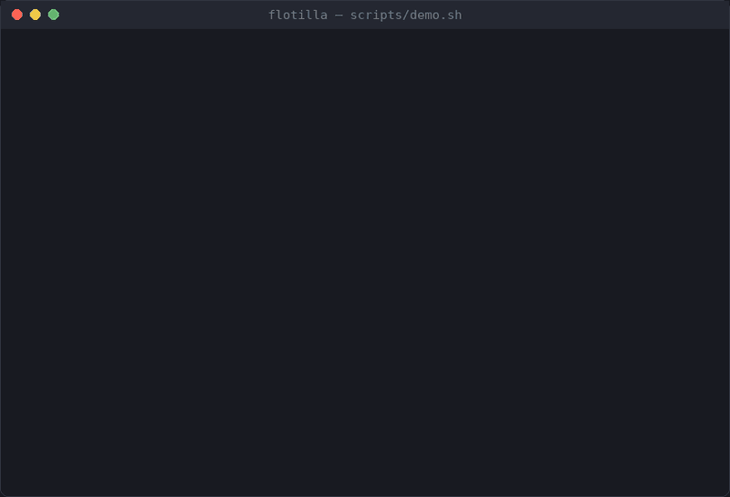

# Flotilla

A [Raft](https://raft.github.io/raft.pdf) consensus implementation in Go, with a replicated key-value store on top and a test harness that breaks the network on purpose.

Raft keeps a cluster of nodes agreeing on one ordered log even when nodes crash and messages are lost, delayed or cut off. Flotilla builds it from the paper and checks it under those failures.

- Leader election with pre-vote and check-quorum, log replication, persistence across restarts
- Snapshots and log compaction, with snapshot transfer to followers that fell behind
- A key-value state machine with exactly-once writes and linearizable reads that cost no log entry
- Cluster membership changes while running: add (through a non-voting learner) and remove, the leader included
- Leadership transfer: hand leadership to a chosen node before maintenance, with no election timeout to wait out
- Real processes over TCP with an HTTP API, a command-line client and on-disk state
- Tested with injected faults and a linearizability checker over recorded histories



## Try it

```sh
./scripts/demo.sh
```

The recording above is this script. It starts a three-node cluster on your machine and walks through a write, losing the leader, restarting a node from disk, adding a node and removing one. It needs Go and cleans up after itself.

## Run with Docker

```sh
docker compose up --build -d                      # three nodes, each with its own volume
docker compose exec node0 flotilla put -server node0:8000,node1:8000,node2:8000 city Paris
docker compose exec node0 flotilla status -server node1:8000
docker compose stop node1 && docker compose start node1   # restarts from its volume
docker compose down                                # add -v to delete the data too
```

Run the client inside the containers as above: followers answer with a redirect to the leader's address, which is a container name that only resolves on the Compose network. Ports 8000-8002 are also published on your machine for `curl`, which works against the leader.

## Run a cluster

```sh
go build -o flotilla ./cmd/flotilla
C=0=127.0.0.1:7000/127.0.0.1:8000,1=127.0.0.1:7001/127.0.0.1:8001,2=127.0.0.1:7002/127.0.0.1:8002
./flotilla server -id 0 -cluster $C -data data0     # one terminal per node
./flotilla server -id 1 -cluster $C -data data1
./flotilla server -id 2 -cluster $C -data data2
```

`-cluster` lists `id=raftAddr/httpAddr` for every node. Without `-data`, state is kept in memory only.

```sh
./flotilla put -server 127.0.0.1:8000,127.0.0.1:8001 city Paris   # followers redirect to the leader
./flotilla get -server 127.0.0.1:8001 city
./flotilla status -server 127.0.0.1:8002
```

Stop the leader with Ctrl-C and the others elect a new one and keep serving. Start it again with the same `-data` directory and it rejoins and catches up.

To change the cluster, start the new node with `-join` (its own entry in `-cluster` gives its addresses), then add it. It joins as a learner and is promoted once it has caught up:

```sh
./flotilla server -id 3 -cluster 3=127.0.0.1:7003/127.0.0.1:8003 -data data3 -join
./flotilla add -server 127.0.0.1:8000 3 127.0.0.1:7003/127.0.0.1:8003
./flotilla members -server 127.0.0.1:8000
./flotilla remove -server 127.0.0.1:8000 0
```

To take the leader down without clients waiting for an election, hand leadership to another voter first:

```sh
./flotilla transfer -server 127.0.0.1:8000 2     # node 2 becomes leader
```


The HTTP API is `GET|PUT|DELETE /kv/{key}`, `GET /status`, `GET /healthz` (503 once the node is removed from the cluster), `GET /metrics` (Prometheus gauges: leader, term, commit and log indexes, members), and for membership `GET /admin/members`, `PUT /admin/members/{id}` (the body is the node's address) and `DELETE /admin/members/{id}`, and `PUT /admin/leader/{id}` to hand leadership to voter `{id}` (204 once the leader has stepped down, 409 if `{id}` cannot lead, 504 if it did not take over in time and the leader carries on).

## Use as a library

```go
node, _ := raft.New(raft.Config{
    ID:        0,
    Peers:     []int{0, 1, 2},
    Transport: transport,                 // sends RPCs to the other nodes
    Storage:   raft.NewMemoryStorage(),
    ApplyCh:   applyCh,                   // committed entries arrive here, in order
})
node.Start()
index, term, isLeader := node.Propose([]byte("command"))
err := node.Snapshot(index, stateMachine.Snapshot()) // the state machine decides when to compact
```

Or the key-value service with its retrying client:

```go
clerk := server.NewClerk(1, servers) // a unique non-zero client ID
clerk.Put(ctx, "x", "1")
value, found, err := clerk.Get(ctx, "x")
```

## Layout

```
raft/            the algorithm: election, replication, snapshots, membership, Node API
simnet/          in-memory network with drops, delays, isolation and partitions
transport/tcp/   Raft RPCs over TCP (net/rpc with gob), with timeouts and reconnects
kv/              key-value state machine: puts, gets, deletes, exactly-once sessions, snapshots
server/          service on a Raft node: client API, HTTP handler, retrying client (Clerk)
linearize/       checker that decides whether a recorded history is linearizable
internal/runner/ starts one node: TCP transport, on-disk storage, HTTP API
cmd/flotilla/    command-line server and client
scripts/         demo.sh
docs/            design notes
```

## Tests

```sh
go test -race ./...
```

Real nodes run over `simnet` while a nemesis isolates, partitions, crashes and restarts them, with concurrent clients. Every operation is recorded and the checker in `linearize/` verifies the history is linearizable, including while servers are added and removed. Targeted tests cover each safety rule, and I checked they fail when the rule is deliberately broken.

A second test runs five real processes and breaks them with SIGKILL, SIGSTOP and cut network links, then checks the same way:

```sh
FLOTILLA_CHAOS=1 go test ./chaos -run TestChaos -v
```

How it works and what is tested in detail: [docs/design.md](docs/design.md).

## Performance

`FLOTILLA_BENCH=1 go test ./bench -run TestBench -v -timeout 10m` starts three real processes with real TCP and disk and measures them. Results from a 2-CPU virtual machine, 100-byte values, 5 seconds per row:

| | 1 client | 8 clients | 32 clients | 128 clients |
|---|---|---|---|---|
| writes, ops/s (p50 latency) | 956 (0.9 ms) | 2,179 (3.2 ms) | 2,457 (11.9 ms) | 2,367 (49 ms) |
| linearizable reads, ops/s (p50) | 4,826 (0.2 ms) | 12,803 (0.5 ms) | 14,695 (1.8 ms) | 13,611 (8.6 ms) |

- Killing the leader with SIGKILL: a write succeeds again through the survivors after about 250 ms (164 to 298 ms over 8 runs).
- `flotilla transfer`: the call returns in about 1 ms and the new leader accepts a write after about 5 ms (8 runs), against the roughly 250 ms of a failover.
- **Writes were limited by how state was saved.** The first version of this benchmark found writes stuck near 300 per second however many clients there were, because every save rewrote the node's whole state and synced three times. State is now kept in an append-only file: a save appends one small record and syncs once. The same benchmark then gave 3 times as many writes with one client and 7 times as many with 32. Before and after, per row: 307 to 956, 352 to 2,179, 317 to 2,457 and 264 to 2,367 writes per second.
- Each save still syncs once while the node holds its lock, so writes that arrive together are synced one after another, not as a group. Syncing a batch at once is the next step if more write throughput is needed.
- These numbers are one machine's. The disk dominates the write rows, so expect them to differ elsewhere.

## Not done

A snapshot remembers the 1,024 most recent removed servers (`Config.MaxGone`), so a removed server that stays away through more removals than that is never told. It is harmless, since a removed server cannot campaign, but it has to be stopped by hand. Details in the design notes.
