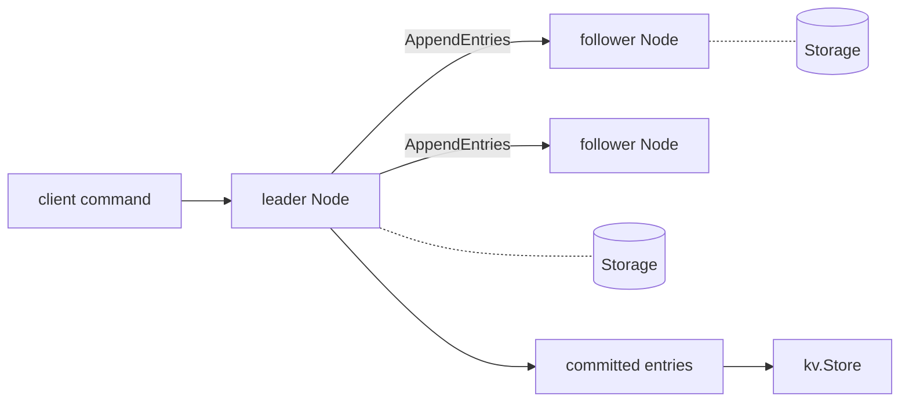

# Flotilla

A [Raft](https://raft.github.io/raft.pdf) consensus implementation in Go, with a replicated key-value store on top and a test harness that breaks the network on purpose.

Raft keeps a cluster of nodes agreeing on one ordered log even when nodes crash and messages are lost, delayed or cut off. Flotilla builds it from the paper and checks it under those failures.

## Status

Working: leader election, log replication, persistence across restarts, and a key-value state machine. Not done yet: log compaction, cluster membership changes, a real network transport and a linearizable client API (see the roadmap).

## Layout

```
raft/     the algorithm: election, replication, persistence hooks, Node API
simnet/   in-memory network with drops, delays, isolation and partitions
kv/       key-value state machine that applies committed entries
```



Networking and storage sit behind two small interfaces (`raft.Transport`, `raft.Storage`), so the same `Node` runs against the simulated network in tests and can run against a real one later.

## Use

```go
applyCh := make(chan raft.ApplyMsg, 256)
node, _ := raft.New(raft.Config{
    ID:        0,
    Peers:     []int{0, 1, 2},
    Transport: transport,                 // sends RPCs to the other nodes
    Storage:   raft.NewMemoryStorage(),
    ApplyCh:   applyCh,                   // committed entries arrive here, in order
})
node.Start()

index, term, isLeader := node.Propose([]byte("command"))
```

## Tests

```sh
go test -race ./...
```

The cluster tests run real nodes over `simnet` and check these cases:

- a single leader is elected and stays stable
- a failed leader is replaced, and the old one steps down when it returns
- no entry commits without a majority
- entries from a partitioned minority leader are discarded when the partition heals
- followers catch up after being cut off
- committed entries survive every node restarting
- progress under 15% message loss and random delay, with concurrent clients

Every applied entry is also compared across replicas, and the test fails if two nodes ever disagree at the same index.

## Design notes

- A new leader appends a no-op entry of its own term. Committing it commits earlier entries safely (paper section 5.4.2).
- A follower reports where its log diverges, so the leader backs up a term at a time.
- Followers truncate only at a real conflict, so delayed or duplicated messages cannot remove correct entries.
- If storage fails, the node panics instead of risking a forgotten vote or entry.

## Roadmap

- Snapshots and log compaction
- A linearizable client API (request deduplication, reads through the leader)
- Linearizability checking of recorded histories
- A TCP transport and a runnable server
- Cluster membership changes
