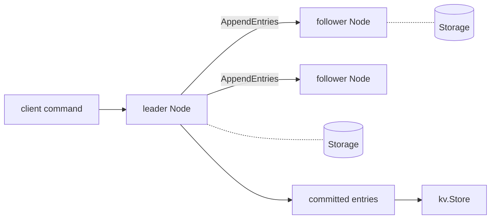

# Flotilla

A [Raft](https://raft.github.io/raft.pdf) consensus implementation in Go, with a replicated key-value store on top and a test harness that breaks the network on purpose.

Raft keeps a cluster of nodes agreeing on one ordered log even when nodes crash and messages are lost, delayed or cut off. Flotilla builds it from the paper and checks it under those failures.

## Status

Working: leader election, log replication, persistence across restarts, snapshots with log compaction, a key-value state machine, and a client API with exactly-once writes and linearizable reads, checked against recorded histories. It runs as real processes over TCP with an HTTP API and on-disk state. Not done yet: cluster membership changes (see the roadmap).

## Layout

```
raft/       the algorithm: election, replication, snapshots, persistence hooks, Node API
simnet/     in-memory network with drops, delays, isolation and partitions
kv/         key-value state machine: puts, gets, deletes, exactly-once client sessions, snapshots
server/     service on top of a Raft node, plus a client (Clerk) that finds the leader and retries
linearize/  checker that decides whether a recorded history of operations is linearizable
transport/tcp/   Raft RPCs over TCP (net/rpc with gob), with timeouts and reconnects
internal/runner/ starts one node: TCP transport, on-disk storage, HTTP API
cmd/flotilla/    the command-line server and client
```



Networking and storage sit behind two small interfaces (`raft.Transport`, `raft.Storage`), so the same `Node` runs against the simulated network in tests and can run against a real one later.

## Use

```go
applyCh := make(chan raft.ApplyMsg, 256)
node, _ := raft.New(raft.Config{
    ID:        0,
    Peers:     []int{0, 1, 2},
    Transport: transport,                 // sends RPCs to the other nodes
    Storage:   raft.NewMemoryStorage(),
    ApplyCh:   applyCh,                   // committed entries arrive here, in order
})
node.Start()

index, term, isLeader := node.Propose([]byte("command"))

// The state machine decides when to compact: tell the node it has applied everything
// up to index and hand over a snapshot. The log before index is dropped.
err := node.Snapshot(index, stateMachine.Snapshot())
```

A snapshot reaches the state machine on `ApplyCh` as an `ApplyMsg` with `SnapshotValid` set, after a restart or when the node fell too far behind. It replaces the state machine's whole state.

### Client API

```go
clerk := server.NewClerk(1, servers) // a unique non-zero client ID
clerk.Put(ctx, "x", "1")
value, found, err := clerk.Get(ctx, "x")
```

Writes go through the replicated log, so a request that returns took effect at one point between its start and its end. A client retries with the same sequence number, and the store remembers each client's latest request, so a retry after a timeout or leader change does not run twice.

Reads use Raft's read index, so they write nothing to the log or the disk. The leader notes its commit index, confirms with one round of heartbeats that a majority still accepts it as leader, waits for its state machine to reach that index, then answers from local state. Right after an election, before the new leader has committed an entry of its own term, reads fall back to the log. `Config.LogReads` forces the old behaviour of sending reads through the log.

## Run a cluster

Build it, then start three nodes, each in its own terminal (`-cluster` lists `id=raftAddr/httpAddr` for every node):

```
go build -o flotilla ./cmd/flotilla
C=0=127.0.0.1:7000/127.0.0.1:8000,1=127.0.0.1:7001/127.0.0.1:8001,2=127.0.0.1:7002/127.0.0.1:8002
./flotilla server -id 0 -cluster $C -data data0
./flotilla server -id 1 -cluster $C -data data1
./flotilla server -id 2 -cluster $C -data data2
```

Talk to any node; followers redirect writes to the leader, and a list of servers lets the client fall back when one is down:

```
./flotilla put -server 127.0.0.1:8000,127.0.0.1:8001 city Paris
./flotilla get -server 127.0.0.1:8001 city
./flotilla status -server 127.0.0.1:8002
```

Stop the leader with Ctrl-C and the others elect a new one and keep serving. Start it again with the same `-data` directory and it rejoins and catches up. Without `-data`, state is kept in memory only.

The HTTP API is `GET|PUT|DELETE /kv/{key}` and `GET /status`.

## Tests

```sh
go test -race ./...
```

The cluster tests run real nodes over `simnet` and check these cases:

- a single leader is elected and stays stable
- a failed leader is replaced, and the old one steps down when it returns
- no entry commits without a majority
- entries from a partitioned minority leader are discarded when the partition heals
- followers catch up after being cut off
- committed entries survive every node restarting
- progress under 15% message loss and random delay, with concurrent clients
- snapshots keep the log short while every replica ends with the same data
- a follower that fell behind the leader's compacted log catches up from the snapshot
- nodes restore their state machine from the snapshot after a restart
- snapshots together with message loss and delay

The server tests run five servers with clients hammering them while a nemesis isolates nodes, splits the cluster 2 / 3 and crashes and restarts nodes. Every operation is recorded and the checker in `linearize/` verifies the whole history is linearizable. Targeted tests check that a leader cut off from the majority refuses reads instead of answering from stale data, that reads add nothing to the log, that a new leader refuses a read index until it has committed in its term, that a read waits for the state machine to catch up, and that a duplicated request runs once. I checked that these tests fail when each guarantee is deliberately broken.

Every applied entry is also compared across replicas, and the test fails if two nodes ever disagree at the same index.

## Design notes

- A new leader appends a no-op entry of its own term. Committing it commits earlier entries safely (paper section 5.4.2).
- A follower reports where its log diverges, so the leader backs up a term at a time.
- Followers truncate only at a real conflict, so delayed or duplicated messages cannot remove correct entries.
- If storage fails, the node panics instead of risking a forgotten vote or entry.
- A snapshot, its index and term, and the log after it are saved in one write, so they cannot disagree after a crash.
- A follower that is behind the leader's snapshot receives it in an `InstallSnapshot` RPC, keeps any entries after it that match, and passes it to the state machine before later entries. The snapshot travels in one message; very large ones would need chunking.

## Roadmap

- Cluster membership changes
